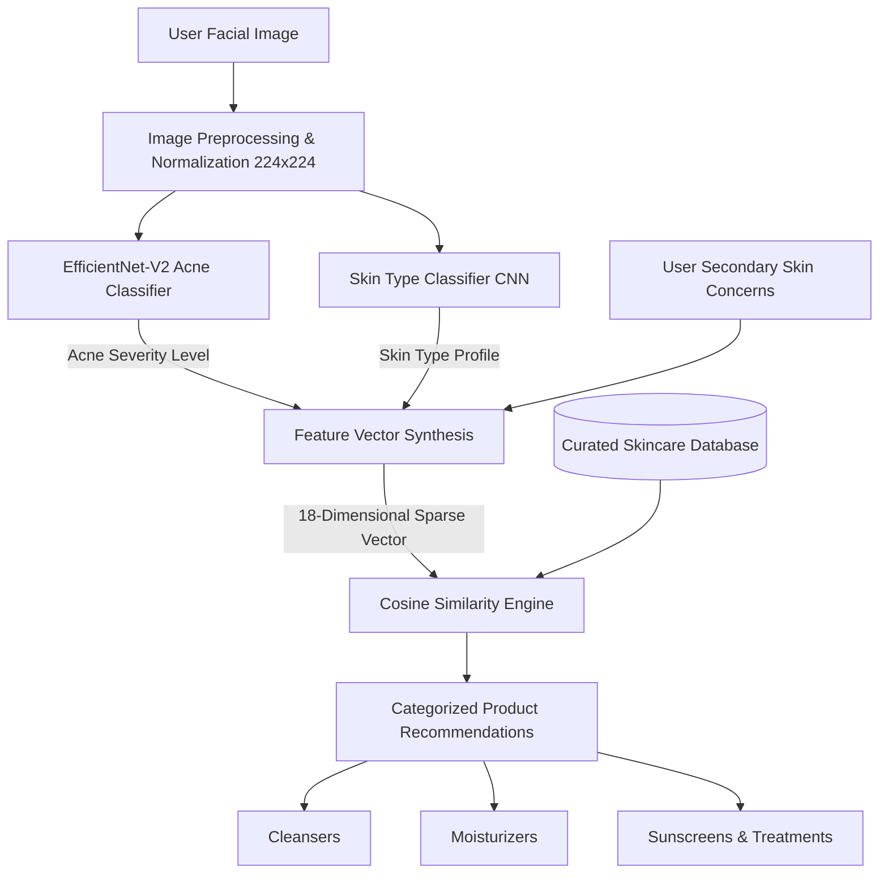

# 🌿 Skincare Sage: AI-Powered Dermatological Analysis & Personalized Skincare Recommendation System

[](https://www.python.org/)
[](https://pytorch.org/)
[](https://streamlit.io/)
[](https://scikit-learn.org/)
[](https://opensource.org/licenses/MIT)
[]()

**Skincare Sage** is an intelligent, end-to-end dermatological advisory system that leverages deep transfer learning and vectorized recommendation algorithms to analyze facial skin conditions and generate personalized skincare regimens.

By combining deep convolutional neural networks (**EfficientNet-V2**) for computer vision inference with a **Cosine Similarity** multi-attribute recommendation engine, Skincare Sage bridges the gap between clinical skin assessment and personalized cosmetic dermatology.

---

## 📌 Table of Contents

- [Overview & Architecture](#-overview--architecture)
- [Key Features](#-key-features)
- [System Pipeline](#-system-pipeline)
- [Tech Stack](#-tech-stack)
- [Repository Structure](#-repository-structure)
- [Getting Started](#-getting-started)
  - [Prerequisites](#prerequisites)
  - [Installation](#installation)
  - [Running the Streamlit Application](#running-the-streamlit-application)
  - [CLI Inference](#cli-inference)
- [Machine Learning & Recommendation Models](#-machine-learning--recommendation-models)
  - [Acne Severity Classifier](#1-acne-severity-classifier)
  - [Skin Type Predictor](#2-skin-type-predictor)
  - [Cosine Similarity Recommender](#3-cosine-similarity-recommender)
- [Datasets & Web Scraping](#-datasets--web-scraping)
- [Roadmap](#-roadmap)
- [Contributing](#-contributing)
- [License](#-license)
- [Author & Acknowledgments](#-author--acknowledgments)

---

## 🔬 Overview & Architecture

Choosing appropriate skincare products often poses a significant challenge due to misidentified skin types, fluctuating acne severity, and vast catalogs of conflicting product ingredients. 

**Skincare Sage** solves this problem through a structured, multi-stage pipeline:
1. **Visual Diagnostic Inference:** Analyzes facial portrait imagery to classify skin type (*Normal, Dry, Oily*) and diagnose acne severity (*Clear, Mild, Severe, Extreme*).
2. **User Attribute Synergy:** Blends visual diagnostic outputs with user-selected secondary skin concerns (e.g., hydration, dark circles, pore care, anti-aging).
3. **High-Dimensional Vector Matching:** Computes similarity metrics across categorized skincare products (cleansers, moisturizers, sunscreens, serums, face masks) to produce ranked, actionable recommendations.



---

## ✨ Key Features

- **Automated Acne Severity Classification:** 4 granular clinical tiers (*Clear*, *Mild*, *Severe*, *Extreme*) trained on facial dermatological datasets.
- **Accurate Skin Type Profiling:** Deep learning inference distinguishing *Normal*, *Dry*, and *Oily* skin patterns based on epidermal texture and sheen.
- **18-Attribute Feature Vectorization:** Incorporates clinical skin conditions and secondary consumer concerns including *hydration, dullness, fine lines, wrinkles, pore care, dark circles, sensitivity*, and *daily maintenance*.
- **Multi-Category Regimen Formulation:** Generates balanced routines across vital skincare categories: Cleansers, Face Moisturisers, Sunscreens, Concealers, and Masks.
- **E-Commerce Metadata Integration:** Real-time catalog entries including product brand, price, target skin type, active concerns, and direct purchase links.
- **Interactive Streamlit Web Dashboard:** Clean, intuitive UI featuring instant drag-and-drop image uploads, visual inspection, and seamless one-click recommendation triggers.

---

## 🛠 Tech Stack

| Component | Technology | Description |
|---|---|---|
| **Deep Learning Framework** | [PyTorch](https://pytorch.org/) & [Torchvision](https://pytorch.org/vision/) | EfficientNet-V2-M backbone, custom MLP classification heads |
| **Recommendation Engine** | [Scikit-Learn](https://scikit-learn.org/) | Cosine Similarity computation, Nearest Neighbors matching |
| **Data Manipulation** | [Pandas](https://pandas.pydata.org/) & [NumPy](https://numpy.org/) | High-performance feature vector encoding & catalog indexing |
| **Image Preprocessing** | [Pillow (PIL)](https://python-pillow.org/) | Tensor transformation, RGB normalization, 224x224 scaling |
| **Web Interface** | [Streamlit](https://streamlit.io/) | Interactive real-time diagnostic dashboard |
| **Data Harvesting** | [Selenium](https://www.selenium.dev/) | Automated web scraper extracting skincare product metadata |
| **Large File Storage** | [Git LFS](https://git-lfs.github.com/) | Versioning for trained `.pt` neural network checkpoints |

---

## 📂 Repository Structure

```text
skincare/
├── .streamlit/
│   ├── config.toml               # Streamlit UI theme and presentation config
│   └── samp                      # Configuration directory anchor
├── models/
│   ├── acne/
│   │   ├── acne_model.py         # PyTorch MyNet architecture (EfficientNet-V2-M)
│   │   ├── acne_infer.py         # Standalone CLI inference module for acne severity
│   │   ├── acne-severity.ipynb   # Model training, loss curves & validation notebook
│   │   └── samp                  # Model placeholder
│   └── skintype/
│       ├── skintype-infer.py     # Standalone CLI inference module for skin type
│       ├── skin-type.ipynb       # Skin type classification training & tuning notebook
│       └── samp                  # Model placeholder
├── recommender/
│   ├── scrap.py                  # Selenium scraper for skincare catalog extraction
│   ├── essential_skin_care.csv   # Curated, verified skincare product dataset
│   ├── result.csv                # Raw scraped product metadata and ingredients
│   ├── recommend.py              # Recommender class with vector cosine similarity
│   └── recommend.ipynb           # Exploratory data analysis & recommender testing
├── saved_models/
│   ├── acne-severity/
│   │   └── best_6.pt             # Trained PyTorch weights for acne severity model
│   └── skintype/
│       └── best_20.pt            # Trained PyTorch weights for skin type model
├── acne-severe.jpg               # Benchmark evaluation sample (Severe acne)
├── acne-test.jpg                 # Benchmark evaluation sample (Test sample)
├── app.py                        # Streamlit web application frontend & pipeline coordinator
├── requirements.txt              # Production Python package requirements
├── .gitattributes                # Git Large File Storage (LFS) rules for .pt weights
├── .gitignore                    # Python, checkpoints, caches, and IDE exclusions
└── README.md                     # Comprehensive project documentation
```

---

## 🚀 Getting Started

### Prerequisites

- **Python 3.9+** installed on your system.
- Git and Git LFS installed (`git lfs install`).
- Optional: CUDA-compatible GPU for accelerated deep learning inference.

### Installation

1. **Clone the repository:**
   ```bash
   git clone https://github.com/Hathim0001/skincare.git
   cd skincare
   ```

2. **Create and activate a virtual environment:**
   - **Windows:**
     ```powershell
     python -m venv venv
     .\venv\Scripts\activate
     ```
   - **macOS / Linux:**
     ```bash
     python3 -m venv venv
     source venv/bin/activate
     ```

3. **Install the required dependencies:**
   ```bash
   pip install --upgrade pip
   pip install -r requirements.txt
   ```

4. **Pull Git LFS model checkpoints:**
   ```bash
   git lfs pull
   ```

---

### Running the Streamlit Application

Launch the interactive dashboard with a single command:

```bash
streamlit run app.py
```

Once running, navigate to `http://localhost:8501` in your web browser:
1. **Upload an image:** Provide a clear portrait or facial close-up (`.jpg`, `.jpeg`, `.png`).
2. **Review Automatic Predictions:** Inspect predicted **Acne Severity Level** and **Skin Type**.
3. **Select Secondary Concerns:** Choose from fine lines, dark circles, hydration, pore care, and more.
4. **Click "Get Recommendations":** Receive prioritized skincare product recommendations complete with direct links and pricing.

---

### CLI Inference

You can also run standalone inference directly from the command line:

- **Predict Acne Severity:**
  ```bash
  python models/acne/acne_infer.py
  ```
- **Predict Skin Type:**
  ```bash
  python models/skintype/skintype-infer.py
  ```
- **Query the Recommender Engine:**
  ```bash
  python recommender/recommend.py
  ```

---

## 🧠 Machine Learning & Recommendation Models

### 1. Acne Severity Classifier
- **Base Architecture:** Pretrained `EfficientNet-V2-M` with ImageNet weights.
- **Custom Classifier Head:**
  ```python
  nn.Sequential(
      nn.Linear(in_features, 512),
      nn.Dropout(p=0.2),
      nn.ReLU(),
      nn.Linear(512, 128),
      nn.Dropout(p=0.2),
      nn.Linear(128, 64),
      nn.Linear(64, 4)
  )
  ```
- **Classes:** `Clear` (0), `Mild` (1), `Severe` (2), `Extreme` (3).
- **Preprocessing:** Resized to $224 \times 224$ pixels, normalized with mean $(0.5, 0.5, 0.5)$ and std $(0.5, 0.5, 0.5)$.

### 2. Skin Type Predictor
- **Architecture:** Convolutional Neural Network with transfer learning.
- **Classes:** `Normal`, `Dry`, `Oily`.
- **Normalization:** Standard ImageNet statistics ($\mu = [0.485, 0.456, 0.406]$, $\sigma = [0.229, 0.224, 0.225]$).

### 3. Cosine Similarity Recommender
- **Feature Space:** 18-dimensional vector encoding primary skin type indicators and active cosmetic concerns:
  $$\vec{F} = [f_{\text{normal}}, f_{\text{dry}}, f_{\text{oily}}, f_{\text{combination}}, f_{\text{sensitive}}, \dots, f_{\text{dark circles}}]$$
- **Similarity Metric:**
  $$\text{Cosine Similarity}(\vec{u}, \vec{v}) = \frac{\vec{u} \cdot \vec{v}}{\|\vec{u}\|_2 \|\vec{v}\|_2}$$
- **Ranking Strategy:** Ranks candidate items within each product classification category and returns the top-$k$ matches with verified metadata.

---

## 📊 Datasets & Web Scraping

The recommendation catalog was constructed using an automated Selenium harvesting script targeting e-commerce skincare listings:
- **`recommender/scrap.py`:** Extracts product titles, brands, prices, active ingredients, formulation types, SPF ratings, and manufacturer-recommended skin concerns.
- **`essential_skin_care.csv`:** Cleaned and deduplicated catalog containing categorized products across 6 vital cosmetic classes.

---

## 🗺 Roadmap

- [ ] **Real-time Camera Stream:** WebRTC camera component for instant mobile browser capture.
- [ ] **Ingredient Safety Analyzer:** Cross-reference active chemicals with allergen and comedogenic indices.
- [ ] **Dermatology LLM Integration:** Conversational assistant for contextual explanations of routines.
- [ ] **REST API Service:** FastAPI endpoints enabling mobile application backend integration.
- [ ] **Quantized Edge Deployment:** ONNX runtime / TensorRT conversion for sub-50ms CPU inference.

---

## 🤝 Contributing

Contributions are warmly welcomed! Please adhere to the following workflow:

1. Fork the Project repository.
2. Create your Feature Branch (`git checkout -b feature/AmazingFeature`).
3. Commit your changes (`git commit -m 'Add some AmazingFeature'`).
4. Push to the Branch (`git push origin feature/AmazingFeature`).
5. Open a Pull Request.

---

## 📜 License

Distributed under the **MIT License**. See `LICENSE` for more information.

---

## 👤 Author & Acknowledgments

- **Hathim** - [@Hathim0001](https://github.com/Hathim0001)
- Built with PyTorch, Streamlit, and Scikit-Learn.
